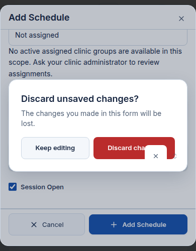

# ClinicFlow / DigiQ — close and dismiss control audit

**Audit date:** 30 October 2026  
**Scope:** audit only, development rendering and source review; no implementation changes.

## Findings at a glance

**One grouped layering issue is confirmed on two pages.** The strongest reproduction is a clear-selection X painted **over the Discard changes button** in a short mobile Add Schedule dialog. This is not a duplicate Radix dialog-close button.

| ID / severity | Page / role | Surface and trigger | Observed versus expected | Viewport / evidence |
|---|---|---|---|---|
| C1a / **Medium** | `/admin/availability` / Superadmin | Add Schedule → choose Monday → scroll dialog body to bottom → header Close | Weekday clear-selection X paints over the red Discard changes button. Expected: all controls belonging to the inert underlying form stay below the discard scrim and panel. At the visible X's centre, hit-testing returns **Discard changes**, not Clear selection. No click at that point was performed. | **390×500**, short-height diagnostic mobile; [screenshot](evidence/schedule-discard-390x500.png), [measurements](evidence/capture-metadata.json). Browser observation `qz3il2`, independently persisted using the same read-only reproduction. |
| C1b / **Low**, same cause | `/admin/availability` / Superadmin | Add Schedule → Monday → header Close | Weekday clear X/affordances remain bright above the dimmed form rather than dimming with it. No geometric overlap of the confirmation card in these taller layouts. Expected: underlying form controls below the scrim. | **390×844** [screenshot](evidence/schedule-discard-390x844.jpg); **1440×900** observation `xbzbf5`. |
| C1c / **Low**, same cause | `/admin/patients` / Superadmin | Add Patient → enter fictional Full Name only → header Close | Phone country selector's clear X remains bright above the scrim. It does **not** horizontally overlap the confirmation panel in this occurrence. Expected: underlying country control dimmed with the rest of the form. Body is inert; no interactive clear control was demonstrated. | **1440×900** [screenshot](evidence/patient-discard-1440x900.jpg); observation `fgvxze`. |

### C1: reproduction and established cause

1. Use a permitted development/test Superadmin context, open `/admin/availability`, set viewport to 390×500. The evidence uses the full application with fictional intercepted API data, no active assigned clinic group, and an empty schedule list.
2. Open **Add schedule**. In **Day of Week**, select **Monday**. No saved record is required; the selection creates a local dirty draft.
3. Scroll the dialog's internal body to its maximum scroll position, not the page behind it.
4. Activate the header **Close**. Do not activate Add Schedule or any saving action.
5. Observe the white clear-selection square/X over the lower-right part of the red **Discard changes** button. It belongs to the weekday selector behind the prompt, not the prompt itself.
6. Dismiss safely with **Keep editing** if retaining a real draft. The audit only discarded fictional, unsaved local drafts.

The independently saved capture measures the underlying clear button at **x=288, y=289.16, 44×44** and Discard changes at **x=185.69, y=272.69, 162.31×44**. They geometrically intersect. Its selector wrapper has computed `z-index:20`, while `.app-discard-scrim` has `z-index:10`. The form body is `inert`, but inertness does not itself move its paint below the scrim. `elementFromPoint` at the visible clear X's centre resolves to `data-testid="button-discard-changes"`. The browser audit's earlier capture placed the X at x=273 with the same vertical position; small horizontal differences do not change the overlap.

Relevant source: `SearchableSelect.tsx` uses the `relative z-20` affordance wrapper; `AppDialog.tsx` renders the body and internal discard scrim as siblings; `app-dialog.css` sets the scrim's layer to 10 and does not isolate the body into a lower stacking context. This rendered/source combination establishes the cause for the listed occurrences. `uniformity.css` was not established as the cause. No CSS or component change was made, including for diagnosis.

**Risk boundary:** the visible glyph can misrepresent the action beneath that point. The audit did not click through it, save an appointment, or demonstrate actual data loss. The default primitive dialog X is hidden and is not the offending glyph.

### Other suspects — not confirmed occurrences

- Any other dirty AppDialog containing SearchableSelect, PhoneInput or other positioned children could have the same paint risk. This is a **source-only propagation hypothesis**, not a finding for every editor/role.
- Multi-select chip/remove and suggestion controls have independent positioned affordances. Their behavior over a dirty scrim was not verified; do not count them as confirmed defects.
- Nested standalone ConfirmDialog and portal-hosted menus/pickers can have different stacking relationships from AppDialog's internal dirty prompt. Their source presence does not prove the same cause.
- The supplied historical screenshot's exact layout, values and glyph intersection were not recreated with those records. The screenshot's **class of symptom** was reproduced with fictional data at 390×500; the exact historical cause remains unproven.

## Reading this report

- [Full route, role and surface inventory](inventory.md): all registered workspace pages, aliases, clinic sections, public/auth routes and shared callers.
- [Browser observation ledger](browser-notes.md): exact inspected roles, routes, viewports, local actions, measurements and evidence references.
- The final findings and coverage summary below distinguish rendered defects from hypotheses. Source reuse is not a substitute for checking an occurrence.

## Safety and method

The managed ClinicFlow web workflow was restarted and its logs showed Vite ready; a narrow public-home screenshot confirmed that the public application rendered. No app, shared component, style, API, dependency, permission, regression-test or fixture implementation was changed. Unrelated slides/design artifacts were not audited.

Signed-in browser checks use isolated fictional intercepted browser contexts. The actual app consumes fictional `/api/me` responses, and the rendered role is checked against that response. These checks establish **frontend rendering only**, not native login or backend authorization. All app API requests in those contexts are intercepted; non-read methods are rejected rather than passed through. Local unsaved form drafts are permitted. No save, live email/SMS, booking, appointment transition, destructive confirmation, permission update or existing customer/patient edit is authorized.

Desktop reference viewport is **1440 × 900** and narrow mobile is **390 × 844** unless a ledger entry states otherwise. Tests include dirty close/Cancel, Keep editing, local discard, nested picker dismissal and mobile shell controls. A legitimate selector clear X is not automatically a misplaced dialog close. A legitimate control can nevertheless have a wrong stacking layer; those are separate questions.

### Classification

| Label | Meaning |
|---|---|
| Confirmed rendered defect | Actual observed bad placement/layering, with a specific role, route, surface, viewport and evidence |
| Checked-clear | No placement defect in the exact rendered state tested, not all possible states of that component |
| Source-only suspect | Risk suggested by source without sufficient rendered evidence |
| Unverified | Inventory exists but the surface/state was not exercised |
| Blocked/unavailable | Specific fixture, identity, record, device or access prerequisite prevented inspection |
| Inapplicable | Route or operation is genuinely absent or redirected for the role, with source explanation |

Severity is based on visible consequence: high when a wrong-layer close can obstruct an important decision or conceal its text; medium for confusing or overlapping dismiss controls without demonstrated loss; low for minor position inconsistency that remains clear and usable. No destructive action is necessary to classify placement.

## Supplied screenshot and root-cause boundary

The supplied Add Schedule screenshot is a historical user observation, not evidence of the current build's root cause. It includes an apparent glyph over the discard prompt. Do not re-publish the screenshot's underlying personal/clinic details in generated evidence.

Current source supplies:

1. a custom header Close in `AppDialog.tsx`;
2. a default Radix close in `ui/dialog.tsx`;
3. a direct-child CSS selector in `app-dialog.css` that hides that default close;
4. a nested internal discard scrim/panel, rather than a second primitive dialog;
5. selectors with their own clear and dropdown affordances.

The browser's Add Schedule inspection found the default close node `display:none` with a zero-sized box and one visible custom header Close, **48 × 44**. Thus the specific “duplicate default dialog X” hypothesis is not confirmed in that occurrence. Neither the mere existence of two source close controls nor an intentional no-X menu establishes a defect. The source and measurements must be tied to the actual screenshot state.

## Coverage boundary

This is **not a comprehensive browser-clearance claim**. The complete source inventory is separate from rendered verification. All five built-in role identities were checked in fictional contexts, but merely reaching their page is not an audit of every popup on it. Native account authentication, actual configured custom-role bindings and real record-dependent operations were not validated.

The matrix in [inventory.md](inventory.md) distinguishes unavailable role/page combinations from registered routes and redirects. In particular:

- Superadmin and Clinic Admin share `/admin` but do not share all administrative pages.
- Clinic Admin's staff/locations/policies live inside its clinic workspace.
- Doctor has its own Clinics/Staff/Booking QR sections and cannot create a patient from the normal Patients list.
- Receptionist's registered schedule/QR routes do not establish create/edit permission.
- Patient has six registered workspace page suffixes, with Settings redirected to Profile and no staff administration.
- Public QR booking is patient-facing even when a staff member is signed in.
- Custom roles restrict Clinic Admin, Doctor or Receptionist base roles; there is no independent custom-role URL set. An empty fictional custom-role response is **not proof that no custom roles are configured in the product**.

Full occurrence results and final evidence references are recorded in the browser ledger and findings summary.

## Rendered coverage summary

All results below are limited to fictional browser contexts. **Clear** means close/dismiss placement only in that state, not a functional approval of the page. `Dsk` = 1440×900; `Mob` = 390×844; `Short` = 390×500.

| Role | Routes / states actually exercised | Desktop | Narrow mobile | Result / limits |
|---|---|---|---|---|
| Superadmin | `/admin/availability`: Add Schedule, Monday dirty Close/Cancel, Keep editing/discard; Start Time picker | Dsk | Mob + Short | C1 above; custom header X and default-close hiding checked. Time picker Escape closed only picker. No available clinic/doctor assignment in fixture; saved Edit Schedule and populated scope not exercised. |
| Superadmin | `/admin/availability`: navigation, notifications, profile menu | — | Mob | Checked-clear sidebar X, empty Notifications X and profile Escape dismissal. No mark-read action; no-X profile menu is intentional. |
| Superadmin | `/admin/patients`: Add Patient dirty Close; Filters drawer | Dsk | Mob filters only | C1c phone-country paint observation on desktop. Confirmation choices and filter header/footer fit; mobile patient editor/dirty prompt not exercised. |
| Superadmin | `/admin/appointments?size=20`: booked detail, Edit Booking Details, row menu, Reschedule, Cancel | Dsk | Unverified | Open/dismiss placement checked-clear. Reschedule had no date/session controls in fixture: content/state coverage unavailable, not cleared. Empty-reason Cancel confirmation disabled; never submitted. |
| Superadmin | `/admin/users?area=roles`: long-name custom-role editor | Dsk | Unverified | Checked-clear header X versus inner Close; horizontal permission-table scroll. Fictional custom role, not an authenticated configured-role staff identity. |
| Superadmin | `/admin/users?area=system`: Effective Permissions drawer, deactivation confirmation, blocked permanent removal review | Dsk | Unverified | Open/cancel placement checked-clear after compatible fictional impact fixture supplied. Initial malformed response/error boundary excluded. No status/removal commit. Counts were not filter-faithful and were not treated as a product defect. |
| Clinic Admin | `/admin/availability`: Add Schedule Monday dirty Close/discard | Dsk | Unverified | Custom X and centered confirmation geometry checked-clear; no separate screenshot or verified paint-over-panel occurrence for this role. |
| Clinic Admin | `/admin/clinics/c1/details`, `/policies`: Clinic Details and Booking Policies | Dsk | Unverified | Checked-clear open/Cancel and long form/visible footer. No dirty nested prompt in these editors. |
| Clinic Admin | `/admin/clinics/c1/staff?tab=receptionists`: Add Staff, Account Recovery Assistance | Dsk | Unverified | Checked-clear open/Cancel/X. Empty staff lists; no existing-account editor, role-change prompt or selected recovery target exercised. |
| Doctor | `/doctor/dashboard`, `/appointments`, `/availability`, `/clinics` including Staff/QR tabs, `/profile` and DOB picker | Dsk | Unverified | Identity/shell/profile and date-picker open/close observed. Location-dependent operations gated by no active location; staff/QR lists empty. Not an editor-clearance result. |
| Receptionist | `/receptionist/dashboard`, `/patients`, `/appointments`, `/queue`, `/availability`, `/profile` | Dsk | Unverified | Identity/shell/profile observed. Operational pages location-gated. No dismissal placement conclusion for their missing editors. |
| Patient | `/patient/dashboard`, `/appointments?size=20`, `/profile`; nav/filter drawers and profile tabs | Unverified | Mob | Checked-clear nav and appointment Filters X. Appointments empty; metrics unavailable; no owned visit action dialogs checked. Profile tabs scrolled without saving. |
| Guest/public | `/`: public Navigation drawer | Initial landing only | Mob | Checked-clear full-height Navigation X and close return to homepage. Public desktop navigation is not the mobile drawer. |
| Guest/public | `/guest-booking` | Empty fixture state | Unverified | No clinic result, therefore populated booking pickers/receipt surfaces unavailable. |
| Guest/public | `/register-clinic`: anonymous account-details stage | Unverified | Mob | Rendered fields and local non-secret draft behavior observed. Back to home had no leave prompt and preserved draft on return; explicit Discard account draft cleared it. Not reported as a placement bug; later verified setup wizard/leave prompts unavailable without verification. No OTP sent. |
| Configured custom-role staff | Base-role routes inherited from A/D/R | Unavailable | Unavailable | Actual configuration/bindings not inspected. Source model inventoried; custom-role editor checked separately under Superadmin, not mislabeled as a custom-role login. |

The browser ledger contains observation IDs for individual clear/unavailable states as well as defect measurements. Those IDs are session references, **not durable file links**. The three linked defect screenshots above and their metadata are persisted in this tracked documentation directory and contain only fictional data.

### Remaining page/state coverage, explicitly not cleared

The following inventory rows have **no rendered close-placement conclusion** beyond any exact occurrence listed above:

- S/A remaining dashboards, clinic list/detail drawers, location editor/hour linkage, schedule day/week editing and nested exception flows, QR preview/actions, Book and owner schedule recovery, queue/decline/expected-duration, report details and communication usage, profile contact prompts.
- S Platform/Integrations/Reference data/Audit/Demo tabs; Communication SMS/Email/Logs provider, results and delivery drawers; S/A Templates, server preview, activation/publication/discard confirmations; S standalone Staff editor/assignment/recovery flows beyond the A Add Staff/recovery states listed above.
- D/R Book, Exceptions, saved appointment/queue/patient/schedule/QR operations, and all narrow-mobile operational surfaces. D branches/legacy aliases and R QR route remain source-inventoried only.
- P Book, owned visit detail/movement/cancel/receipt states, and queue content; desktop Patient overlay placement. All standard role-specific settings aliases were source-mapped, not separately rendered as independent pages.
- Public login/signup/access/recovery/password/demo/onboarding overlays, scanner/camera states, valid public clinic/branch slugs, `/book/:reference`, `/display/:reference`, `/live-ticket`, post-booking guest receipt and post-verification clinic setup.
- Selected/cleared multi-selects, live-search/suggestion result dismissals, columns/saved views/tool overflow menus, populated notifications, safe local toast timing/stacking, month/year and date-range subviews, and nested standalone confirmations not specifically in the ledger.
- Long headings were tested in one desktop custom-role drawer, not every dynamic title or mobile drawer. Scroll/short-height reproduction is verified for Add Schedule and long-form desktop Clinic Details; it is not blanket scroll clearance.

**Reasons:** actual configured-role/native identity access was not used; existing real records/private tokens were deliberately not used as test data; intercepted fixtures lacked active operational assignments and complete appointment/session/receipt contracts; camera and verified-registration states needed additional prerequisites. Some remaining entries were simply **not exercised**, not proven inaccessible. No authentication or permission weakening was used to fill those gaps.

The source inventory remains complete as a route/caller review, while rendered page/role/state coverage remains bounded as above. This report must not be used as a claim that every supported page and role is free of close-placement defects.

## Delivery and verification

- Only audit Markdown, selected privacy-safe screenshots and capture metadata were added. No UI fixes or automated regression implementation.
- The supplied example's dirty-close lifecycle was exercised; its exact historical record/layout was not recreated.
- Persisted screenshot capture also blocked all non-GET/HEAD API calls and recorded **zero non-read requests**.
- Documentation links and evidence paths were checked locally; the PNG/JPEGs were opened and visually inspected.
- No deployment, production change, live communication or customer/patient mutation was performed. Existing discard-overlap implementation work remains separate.
